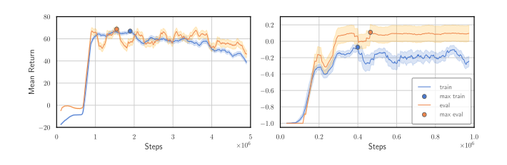

# PyDSMC

***Statistical Model Checking for Neural Agents Using the Gymnasium Interface***

[](https://pypi.org/project/pydsmc/)

[](https://github.com/neuro-mechanistic-modeling/PyDSMC/blob/main/LICENSE)
[](https://github.com/astral-sh/ruff)

PyDSMC is an open-source Python library for statistical model checking of neural agents on arbitrary [Gymnasium](https://github.com/Farama-Foundation/Gymnasium) environments.
It is designed to be lightweight and easy-to-use while being based on [established statistical methods](#statistical-method-selection) to provide guarantees on the investigated agents' performances on various properties.
Implementing the Gymnasium interface, PyDSMC is widely applicable and fully agnostic to the environments underlying implementation.
It works out of the box with [Stable-Baselines3](https://stable-baselines3.readthedocs.io/) agents and any policy exposed as a `predict` callable.

PyDSMC is based on [Deep Statistical Model Checking](https://doi.org/10.1007/978-3-030-50086-3_6) and aims to facilitate greater adoption of statistical model checking by simplifying its usage.

Please consult the [accompanying paper](https://woshicado.eu/publications/2025/pydsmc/PyDSMC.pdf) for more details.

## Why Deep Statistical Model Checking?

- The training and evaluation curves can differ greatly throughout training (see figure below)
  <br>→ Just inspecting the training curves leads to suboptimal policy extraction.
- Reporting an arbitrary number of seeds does not provide (statistical) guarantees
- Reporting min/max or standard deviation is much less informative than a confidence interval

Therefore,
- PyDSMC advocates performing statistically backed model evaluations periodically throughout training to ensure a good extraction point,
- and then analyzing the extracted policy post-training to provide unbiased and accurate performance results.



## Feature highlights

- **Environment-agnostic** — evaluate any Gymnasium environment.
- **Sound guarantees** — confidence intervals from established statistical methods (Clopper–Pearson, Wilson, Hoeffding, DKW, Empirical Bernstein Stopping, …).
- **Automatic method selection** — PyDSMC picks a suitable statistical method from your property's parameters.
- **Arbitrary properties** — analyze return, crash probability, or any custom trajectory-based metric you define.
- **Parallel evaluation** — vectorized environments to speed up evaluations
- **High-level interface** — property definition and evaluation in only a few lines of code.

## Quickstart

```python
import gymnasium as gym
from pydsmc import Evaluator, create_predefined_property

# Any Gymnasium environment works.
env = gym.make("CartPole-v1")
evaluator = Evaluator(env=env)

# Analyze the achieved return with a sound confidence interval.
evaluator.register_property(
    create_predefined_property(
        property_id="return",
        epsilon=0.05,         # half-width of the confidence interval
        kappa=0.05,           # 1 - kappa is the confidence level
        relative_error=True,  # epsilon relative to the mean
        bounds=(0, 500),      # CartPole-v1 return is in [0, 500]
        sound=True,           # request a sound statistical method (expensive)
        gamma=0.99,           # discount factor for the return
    ),
)

# `predict_fn` returns an action for a batch of observations.
results = evaluator.eval(
    # This `predict_fn` would be replaced with your trained agent's policy.
    predict_fn=lambda obs, **_: (env.action_space.sample(), None),
    stop_on_convergence=True,  # Stop evaluating on property convergence
    episode_limit=2_000,       # Stop if not converged after 2,000 episodes
)
```

See [Usage](usage.md) for a full walkthrough and [Examples](examples.md) for end-to-end scripts on
real trained agents.

## Where to next?

- [Installation](installation.md) — install from PyPI and set up a dev environment.
- [Usage](usage.md) — properties, the evaluator, and statistical-method selection.
- [Examples](examples.md) — complete scripts on trained agents.
- [API Reference](reference/index.md) — the full public API.
- [Citation](citation.md) — the paper and BibTeX entry.
