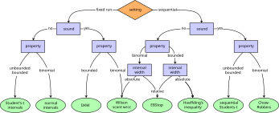

# Usage

PyDSMC exposes two core concepts:

- **properties** describe _what_ you want to measure, and
- the **evaluator** runs Monte-Carlo rollouts until each property's confidence interval has converged (or a
  resource budget is exhausted).

The typical workflow is:

1. Create one or more [properties](#properties).
2. Construct an [`Evaluator`](#the-evaluator) over your (vectorized) environment(s).
3. Register the properties and call [`eval`](#running-an-evaluation).
4. [Read the results](#reading-results).

## Properties

PyDSMC can analyze arbitrary trajectory-based properties, including environment-specific ones.
A property maps a trajectory to a single `float` sample.
PyDSMC then estimates the mean of that value with a confidence interval using established statistical methods.

### Predefined properties

For convenience, PyDSMC provides ready-to-use, domain-independent properties that are parameterized and can be adapted to each use case.
List them with:

```python
import pydsmc

pydsmc.get_predefined_properties()
```

Create one with [`create_predefined_property`][pydsmc.create_predefined_property]. For example, a
property analyzing the achieved (discounted) return:

```python
from pydsmc import create_predefined_property

return_property = create_predefined_property(
    property_id="return",    # which predefined property to use
    name="returnGamma0.97",  # property name, used for storing results
    epsilon=0.025,           # half-width of the requested confidence interval (CI)
    kappa=0.05,              # probability that the true mean lies outside the CI
    relative_error=True,     # whether epsilon is a relative or absolute error
    bounds=(0, 864),         # min and max possible values of the property
    sound=True,              # whether a sound statistical method must be used
    gamma=0.97,              # property-specific attribute
)
```

### Custom properties

Create your own property with [`create_custom_property`][pydsmc.create_custom_property]. The only
extra information required is a `check_fn` that receives the property instance and a trajectory, and
returns a `float` sample:

```python
from pydsmc import create_custom_property

# The trajectory is a list of steps; each step is
# (obs, action, reward, terminated, truncated, info).
# Each step's field can be accssed by index or `.<field>` (i.e., `t[i].reward == t[i][2]`).
crash_property = create_custom_property(
    name="crash_prob",
    epsilon=0.025,
    kappa=0.05,
    relative_error=False,
    binomial=True,  # this property follows a binomial distribution
    bounds=(0, 1),
    sound=False,
    # A crash is identified by a final reward of -100.
    check_fn=lambda self, t: float(t[-1].reward == -100),
)
```

!!! note "Trajectory format"
    Each entry in the trajectory passed to `check_fn` is a tuple
    `(observation, action, reward, terminated, truncated, info)`. `t[-1]` is the final step, so
    `t[-1][2]` is the last reward.

## The Evaluator

Before constructing an [`Evaluator`][pydsmc.Evaluator], create the evaluation environment(s). The
evaluator accepts a single environment, a single vectorized environment, or a list of vectorized
environments (one per worker thread). Any vectorized Gymnasium environment
(`gym.vector.SyncVectorEnv` / `AsyncVectorEnv`) or Stable-Baselines3 `VecEnv` works.

The helper [`create_eval_envs`][pydsmc.create_eval_envs] builds a suitable set of vectorized
environments from a configuration:

```python
import gymnasium as gym
from stable_baselines3.common.monitor import Monitor

from pydsmc import Evaluator, create_eval_envs

NUM_THREADS  = 1  # Recommended: 1; often better to use more parallel environments instead.
NUM_PAR_ENVS = 8  # Number of parallel environments *per thread*.

envs = create_eval_envs(
    gym_id="HalfCheetah-v5",
    env_seed=42,  # seeds are incremented per environment, making each unique
    num_threads=NUM_THREADS,
    num_envs_per_thread=NUM_PAR_ENVS,
    wrappers=[gym.wrappers.NormalizeObservation, Monitor],
    vecenv_cls=gym.vector.AsyncVectorEnv,  # or SyncVectorEnv, sb3 DummyVecEnv/SubprocVecEnv
    # Unknown kwargs are forwarded to gym.make (and then to the environment).
    max_episode_steps=1000,
)

evaluator = Evaluator(env=envs)
```

!!! tip "Threads vs. parallel environments"
    In our experiments, we observed that `num_threads=1` and increasing the number of parallel environments per thread instead is often superior to increasing the number of threads.

### Running an evaluation

Register the properties and start evaluating. The evaluator keeps sampling until all properties with a set `epsilon` have converged (`stop_on_convergence=True`) or a resource limit is hit.

```python
evaluator.register_property(return_property)
evaluator.register_property(crash_property)
# Or register several at once:
# evaluator.register_properties([return_property, crash_property])

results = evaluator.eval(
    agent=agent,               # e.g., a stable baselines3 agent
    stop_on_convergence=True,  # stop once all properties converged
    episode_limit=10_000,      # early stop after 10,000 episodes
    time_limit=60,             # early stop after 60 minutes
    num_episodes_per_policy_run=100,
    num_threads=NUM_THREADS,
    deterministic=True,        # forwarded to the agent's predict()
)
```

!!! warning "At least one stopping criterion is required"
    You must set at least one of `episode_limit`, `time_limit`, or `stop_on_convergence=True` together with at least one property that has an `epsilon`.
    Otherwise the evaluation would never terminate, and `eval` raises a `ValueError`.

    Provide the policy either as an `agent` with a `predict(obs, ...)` method (e.g. any Stable-Baselines3 model) or directly as a `predict_fn` callable. Extra keyword arguments (like `deterministic=True`) are forwarded to the policy.

### Reading results

If a `log_dir` is set, results are written under the evaluator's `log_dir` as JSON Lines.
Otherwise, they can be extracted from the properties, e.g., by calling [get_log_line][pydsmc.Property.get_log_line] on each property:
Use [`jsons_to_df`][pydsmc.jsons_to_df] to aggregate them into a pandas `DataFrame`:

```python
from pydsmc import jsons_to_df

df = jsons_to_df(log_dir)  # aggregate the latest run into a DataFrame (and save it)
print(df)
```

## Parameters

The most important property parameters:

| Parameter        | Meaning                                                                                                                                                                                    |
| ---------------- | ------------------------------------------------------------------------------------------------------------------------------------------------------------------------------------------ |
| `epsilon`        | Half-width of the confidence interval. With `relative_error=True` it is relative to the estimate; otherwise absolute. `None` runs a fixed number of episodes without a convergence target. |
| `kappa`          | Error probability — the confidence level is `1 - kappa`.                                                                                                                                   |
| `relative_error` | Whether `epsilon` is a relative (`True`) or absolute (`False`) error.                                                                                                                      |
| `bounds`         | The property's minimum and maximum possible values. Required for some methods.                                                                                                             |
| `binomial`       | Whether the property is binomial (a 0/1 indicator, e.g. crash probability).                                                                                                                |
| `sound`          | Whether a sound statistical method must be used (guaranteed coverage) vs. a faster unsound one.                                                                                            |
| `min_samples`    | Minimum number of samples before convergence may be declared.                                                                                                                              |
| `st_method`      | Provide an explicit statistical method instead of letting PyDSMC pick one automatically.                                                                                                   |

## Statistical method selection

For each property, PyDSMC automatically selects an appropriate statistical method based on the
provided parameters, following the decision tree below. You can always override the choice by passing
an explicit `st_method`.


